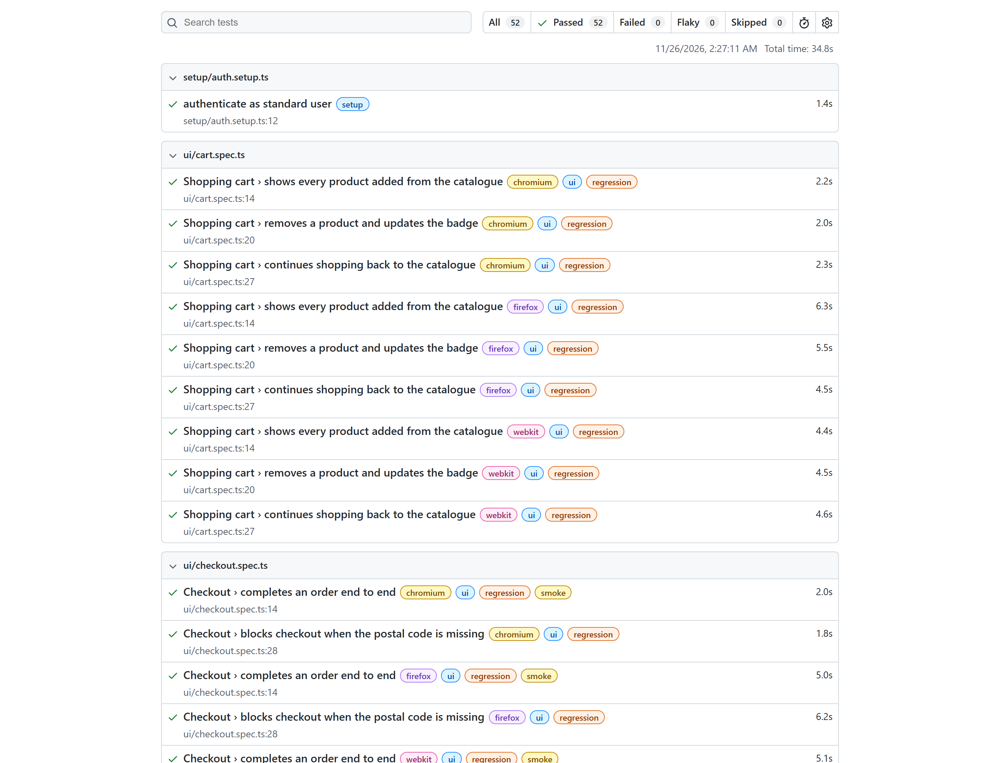

# Playwright + TypeScript Test Automation Framework

[](https://github.com/ManikandanK-QA/playwright-typescript-framework/actions/workflows/ci.yml)
[](https://playwright.dev/)
[](https://www.typescriptlang.org/)
[](LICENSE)

**[Live Allure report →](https://manikandank-qa.github.io/playwright-typescript-framework/)** (published by CI on every push to `main`)

A layered test automation framework for **UI, REST API and accessibility** testing,
built with Playwright and TypeScript. It is deliberately structured the way a
maintained suite is structured in a team: page objects without assertions,
fixtures for dependency injection, contract-validated API responses, validated
configuration, and a CI pipeline that separates layers instead of running
everything against every browser.

Suites run against stable public demo systems — **SauceDemo** (sign-in, catalogue,
cart, checkout) and **Restful Booker** (token auth, full CRUD). Clone it, install,
run it. No secrets, no local services, no accounts.



## What this demonstrates

- **Layered project topology** — UI, API and accessibility suites run in their own
  Playwright projects; API tests do not execute three times under three browsers.
- **Page Object Model with a clean contract** — page objects expose intent and
  locators, specs own every assertion, so failures point at the test line.
- **Fixture-driven setup and cleanup** — a `bookings` fixture creates records on
  demand and deletes them in teardown, even when a test fails midway.
- **Contract validation, not just status codes** — every API response is parsed
  through a Zod schema before assertions run.
- **Configuration that fails fast** — environment values are validated at startup
  with actionable error messages.
- **Real CI engineering** — quality gate, per-browser jobs, separate API/a11y jobs,
  least-privilege tokens, Allure published to GitHub Pages.
- **Cross-browser UI** — Chromium, Firefox and WebKit from a single suite.

## Stack

| Concern | Tool |
| --- | --- |
| Test runner | Playwright Test 1.65 |
| Language | TypeScript 5.9 (strict, `noUnusedLocals`, `verbatimModuleSyntax`) |
| API contracts | Zod 4 |
| Test data | `@faker-js/faker` factories + typed static data |
| Accessibility | `@axe-core/playwright` (WCAG 2.0/2.1 A & AA) |
| Reporting | Playwright HTML, JUnit XML, Allure |
| Quality | ESLint 10 (type-aware), Prettier |
| CI | GitHub Actions, Node 22 LTS |

> TypeScript is intentionally held at 5.9: `typescript-eslint` currently supports
> `<6.1`, so upgrading to TS 7 would disable type-aware linting until the
> toolchain catches up.

## Architecture

```
tests/            scenarios and assertions
  setup/          one-time authentication → storageState
  ui/             sign-in, catalogue, cart, checkout
  api/            auth, CRUD, negative paths
  a11y/           axe-core scans

src/
  pages/          page objects (intent + locators, no assertions)
  components/     shared UI fragments (header, cart badge)
  api/            ApiClient, BookingApi, Zod schemas
  fixtures/       pages, apiClient, bookingApi, bookings
  data/           static data + synthetic factories
  config/         validated environment, shared paths
  utils/          structured logger
```

Full design notes: [docs/architecture.md](docs/architecture.md) ·
Test approach: [docs/test-strategy.md](docs/test-strategy.md) ·
Pipeline: [docs/ci.md](docs/ci.md).

### Project split

| Project | Suite | Browser | Authentication |
| --- | --- | --- | --- |
| `setup` | auth setup | Chromium | signs in, writes `.auth/standard-user.json` |
| `chromium` | `tests/ui` | Chromium | reused session |
| `firefox` | `tests/ui` | Firefox | reused session |
| `webkit` | `tests/ui` | WebKit | reused session |
| `api` | `tests/api` | none | bearer/cookie token per instance |
| `a11y` | `tests/a11y` | Chromium | signed out |

## Quick start

Requirements: **Node.js 20+** (CI uses 22 LTS) and npm.

```bash
git clone https://github.com/ManikandanK-QA/playwright-typescript-framework.git
cd playwright-typescript-framework

npm ci
npx playwright install --with-deps

npm test
```

On Windows, use `npm ci` and `npx playwright install` in an elevated shell if the
`--with-deps` flag is unsupported; browser dependencies are only needed on Linux.

Configuration is optional — the defaults point at the public demo systems:

```bash
cp .env.example .env      # Windows: copy .env.example .env
```

## Commands

| Command | Runs |
| --- | --- |
| `npm test` | every project (setup + 3 browsers + api + a11y) |
| `npm run test:ui` | UI suite on all three browser projects |
| `npm run test:api` | REST suite only |
| `npm run test:a11y` | accessibility suite only |
| `npm run test:smoke` | `@smoke`-tagged tests |
| `npm run test:regression` | `@regression`-tagged tests |
| `npm run test:chromium` | UI suite on Chromium only |
| `npm run test:headed` | headed mode (local debugging) |
| `npm run test:debug` | Playwright Inspector |
| `npm run report` | open the last HTML report |
| `npm run allure:generate` | build the Allure report (requires Java 17) |
| `npm run validate` | typecheck + lint + format check (the CI gate) |

## Coverage

| Layer | Scenarios |
| --- | --- |
| Authentication | valid sign-in; locked-out user; wrong password; missing username; missing password |
| Catalogue | six products listed; ascending price sort; add/remove with badge synchronisation |
| Cart | contents reflect additions; removal updates count; continue shopping |
| Checkout | end-to-end purchase with confirmation; mandatory postal code |
| API auth | token issued; invalid credentials rejected (including the service's HTTP 200 + reason quirk) |
| API CRUD | create/read; name filter; full update; partial update; delete then verify 404 |
| API negative | unknown id → 404; write without token → 403; invalid create payload → 500 |
| Accessibility | axe-core scan of the sign-in page; critical violations fail the build |

Authentication, catalogue and checkout each carry an `@smoke` case; API auth and
CRUD carry one as well. The smoke subset is the intended pre-merge gate.

## Configuration

| Variable | Default | Purpose |
| --- | --- | --- |
| `BASE_URL` | `https://www.saucedemo.com` | UI target |
| `API_BASE_URL` | `https://restful-booker.herokuapp.com` | REST target |
| `SAUCE_USERNAME` / `SAUCE_PASSWORD` | `standard_user` / `secret_sauce` | UI credentials |
| `BOOKER_USERNAME` / `BOOKER_PASSWORD` | `admin` / `password123` | API credentials |
| `LOG_LEVEL` | `info` | `debug`, `info`, `warn`, `error` |

Values are parsed and validated by `src/config/env.ts`. An invalid URL or log
level stops the run with a field-level error before any browser launches.
`.env` and `.auth/` are git-ignored; only `.env.example` is committed.

## Reporting

Every run produces:

- **Playwright HTML** — `npm run report`
- **JUnit XML** — `test-results/junit.xml`, for CI dashboards and test-management imports
- **Allure results** — `allure-results/`, rendered by CI into one combined report
  and published to GitHub Pages: <https://manikandank-qa.github.io/playwright-typescript-framework/>.
  The report keeps trend history across runs.

Traces, screenshots and video are retained on failure (`trace: retain-on-failure`).
A failing test is diagnosed from the artifact, not by re-running it locally.

## CI/CD

`.github/workflows/ci.yml`:

```
quality (typecheck + lint + format)
   ├─ ui: chromium
   ├─ ui: firefox
   ├─ ui: webkit
   ├─ api
   └─ a11y
        └─ publish (main only) → combined Allure report → gh-pages
```

The pipeline installs the target browser plus Chromium for the auth setup, uploads
reports and failure artifacts, and keeps the default token read-only except for
the publish job.
To enable the report: **Settings → Pages → Deploy from branch → `gh-pages` / root**.

Details and troubleshooting: [docs/ci.md](docs/ci.md).

## Design decisions

**Why API tests are not part of the browser matrix.** REST calls do not depend on
a rendering engine. Running them per browser triples runtime and inflates pass
counts without adding signal.

**Why assertions are not in page objects.** Encapsulating `expect` inside pages
makes failures report framework lines and forces linters to disable
`expect-expect`. Specs keep assertions; pages keep interactions.

**Why Zod contracts.** Status-code-only assertions pass when a field silently
changes type or disappears. Contract parsing catches schema drift at the boundary,
with the exact failing path.

**Why fixture teardown instead of `describe.serial`.** A serial lifecycle lets one
failure cascade into every subsequent test and leaks data when a mid-flow step
fails. Per-test fixtures are independent, parallel-safe and self-cleaning.

**Why validated configuration.** Silent fallbacks turn a typo into a mysterious
timeout. Startup validation converts it into a one-line fix.

## Verified locally

| Check | Result |
| --- | --- |
| `npm run validate` | typecheck, lint and format check clean |
| `npm test` | **52/52 passed** in 34.8s (Chromium, Firefox, WebKit, API, a11y) |
| Environment | Windows 11 · Node 26.13.1 · Playwright 1.65.1 |
| Verified on | 26 November 2026 |

The screenshot above is the HTML report from that run, not a mock-up.

## Limitations

- Both targets are third-party public demos. They can change or go offline; this
  repository has no control over their availability.
- Restful Booker is a shared instance. Tests assert only on records they created,
  but other users' data is visible in list responses.
- Allure **report generation** needs Java 17 locally; test execution does not.
- Visual regression, performance and security testing are intentionally out of
  scope here and belong to the companion repositories.

## License

MIT — see [LICENSE](LICENSE).

## Acknowledgements

Architecture reviewed against
[lebrodus/playwright-typescript-framework](https://github.com/lebrodus/playwright-typescript-framework)
(MIT) as a learning reference. All code in this repository is original; the
reference's author, branding and assets are not reused.

## Author

**Manikandan Kandasamy** — Senior Software Test Engineer
[GitHub](https://github.com/ManikandanK-QA) · [Email](mailto:manikandan.auto.qa@gmail.com)
